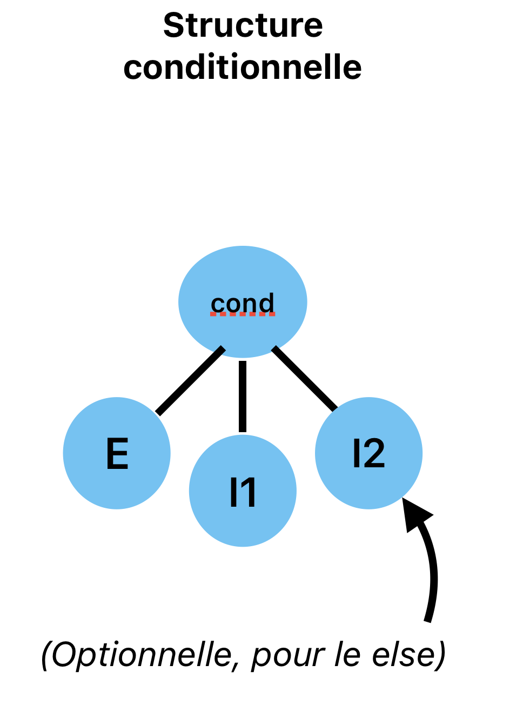
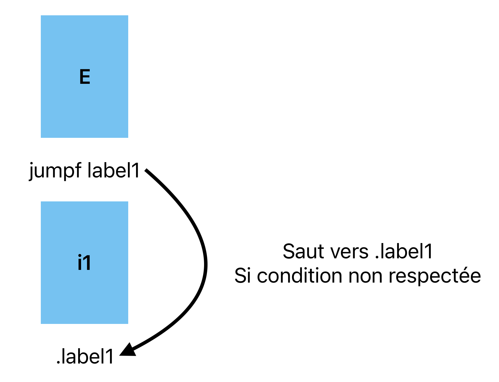
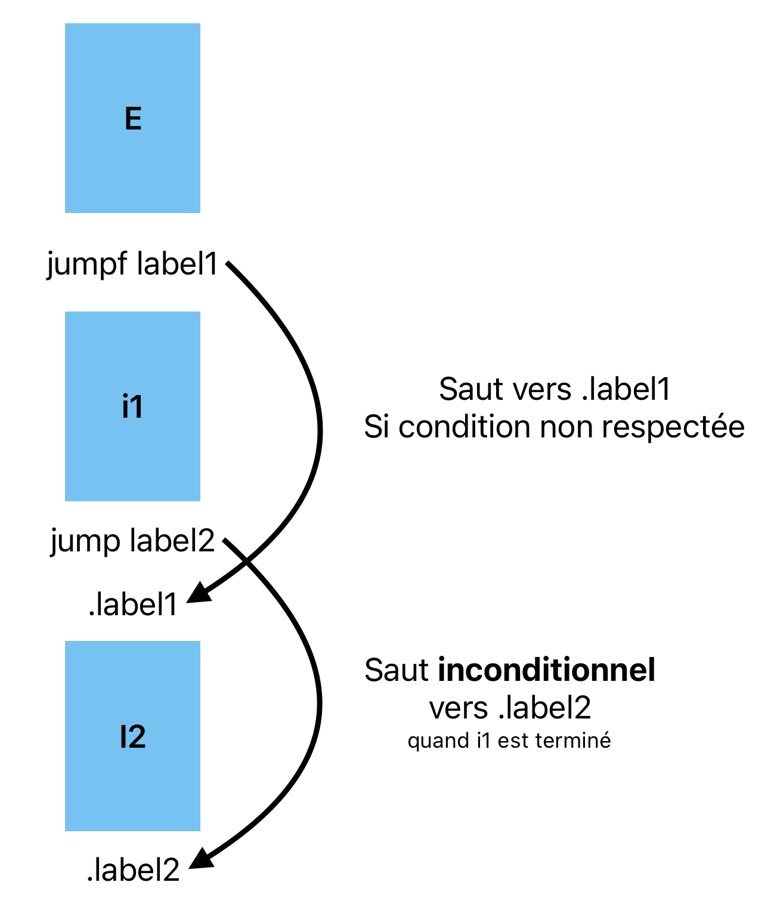
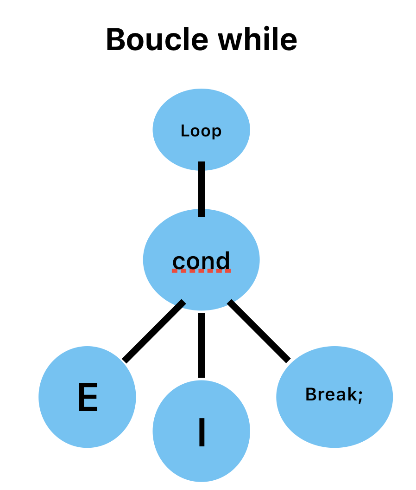
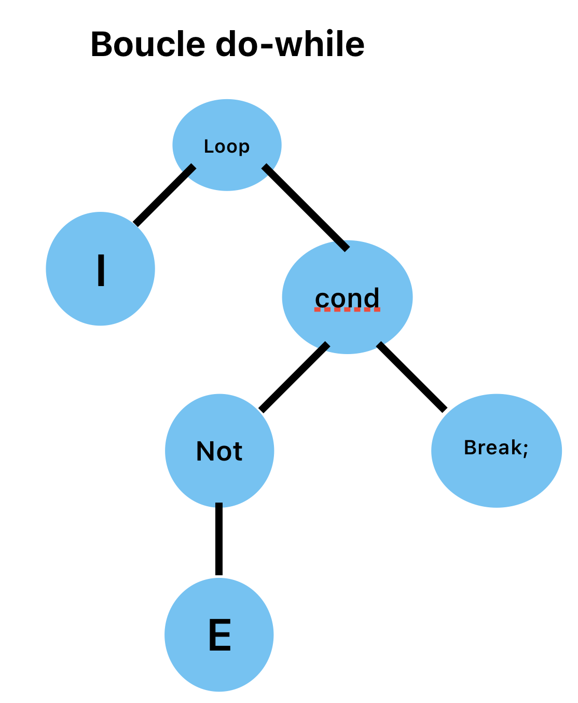
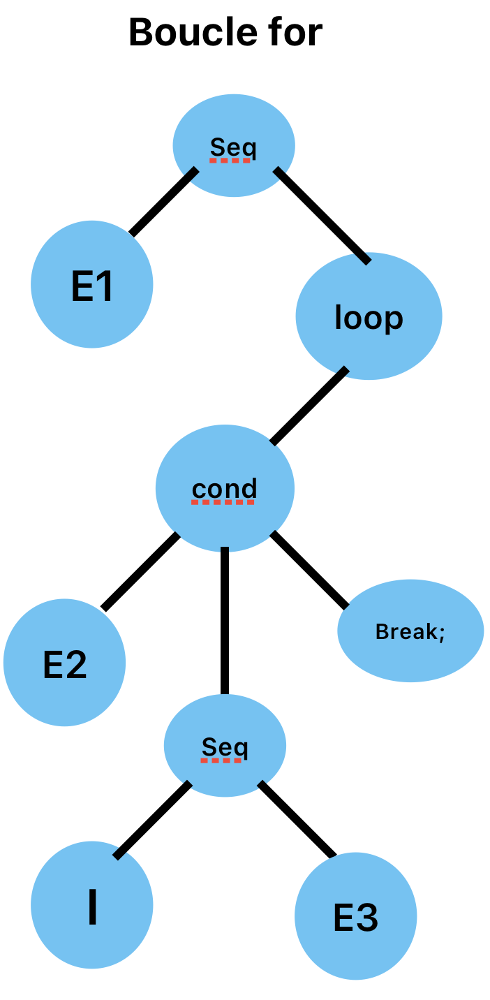
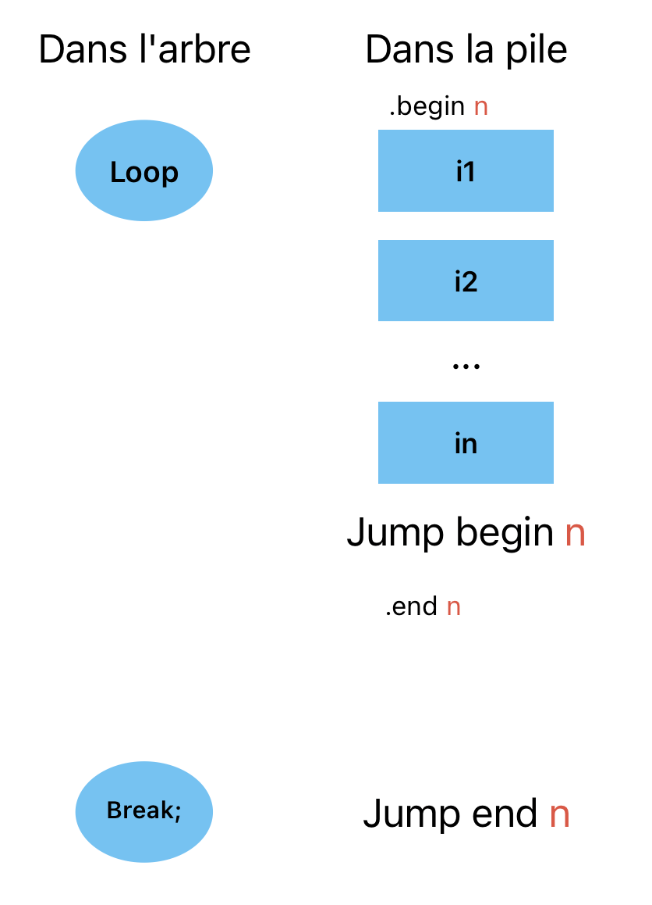

16 novembre 2026

# Boucles et conditionnelles

## Conditionnelles - `if` et `else`

**Le if est une instruction** : Token IF, Token LParent, Expression, Token RParent, Instruction

```java
I -> if '(' E ')' I (else I)? // Le else est optionnel
```

Ici, l’instruction après le `if` et la condition ou le `else` peut être une seule instruction ou une **série d’instructions** dans un **bloc**.

Regex attendue :

```java
I -> E `;` | `{` I* `}` 
```

**Attention à la portée des conditionnelles !**

```java
if (a == 1) 
	if (b == 2) x = 3;
	else x = 5;
```

Ce code est autorisé, et le else s’applique au deuxième if

```java
if (a == 1) 
	if (b == 2) x = 3;
else x = 5;
```

Même si ce else est aligné différemment, le `else` s’applique toujours au deuxième `if` ! Sinon, utiliser des `{}`

**Code dans l’analyse syntaxique :**

```java
// Dans le I()
// ...
} else if(check(tok_if)) {

	// On attend un truc du style ( E )
	accept(tok_lparent);
	Node e = E(); 
	accept(tok_rparent);
	
	// Puis on analyse les instructions 
	Node i1 = I();
	
	// On commence à construire notre noeud 
	// (avec un nouveau type 'conditionnelle')
	Node r = new Node(nd_cond, e, i1);
	
	// Si on trouve un else 
	if (check(tok_else)) {
		Node i2 = I();
		Ajouterenfant(r, i2);
	}
}
```

**Structure du nœud attendue :**



**Dans la pile :**

On place d’abord la condition (une expression E).

Puis on place un jump (jump true ou jump false), qui vérifie si la valeur obtenue de l’expression de la condition est vraie ou fausse. Généralement on place des `jumpf` (false) après les expressions.

Un jump ressemble à ça : `jumpt <label>` ou `jumpf <label>`

Chaque **label** est un numéro unique, afin de distinguer les différentes portées de if-else.

Schématiquement, le jump dans la pile se présente comme ceci :



**Et pour le if-else :**



En général, le label unique est un id qui s’incrémente

**Dans le code :**

```java
case nd_cond :
	int label = nbLabel++; // nbLabel à déclarer
	gennode(N.enfant[0]);
	System.out.println("jumpf " + label);
	gennode(N.enfant[1]);
	
	// ... Je te laisse déduire le reste du code bg
```

## Boucles

**Boucle `while`**

Regex attendue :

```java
while '(' E ')' I
```

Son arbre sémantique ressemblerait à ça :



Le `I` est répété à l’infini, tant que la condition (E) est vraie. Et dès lors que ça devient faux → `break`. Mais `break` peut aussi être utilisé lorsqu’il y a explicitement un token `break;` dans le code.

Pour simplifier cet arbre, on va nommer les noeud comme ceci :

Loop → L

Cond → C

Break → B

**Dans le code de l’analyse syntaxique :**

```java
// Dans le I()
// ...
} else if(check(tok_while)) {

	// On attend un truc du style ( E )
	accept(tok_lparent);
	Node E = E(); 
	accept(tok_rparent);
	
	// On repère la ou les instruction(s)
	Node I = I();
	
	// On construit les autres composantes de l'arbre (cf. arbre 'Boucle while')
	Node L = new Node(n_loop);
	Node C = new Node(n_cond);
	Node B = new Node(n_break);
	
	// Puis on ajoute les enfants
	ajouter_enfant(L, C);
	ajouter_enfant(C, E);
	ajouter_enfant(C, I);
	ajouter_enfant(C, B);
```

**Boucle `do - while`**

Regex attendue :

```java
do '{' I '}' while '(' E ')';
```

Son arbre sémantique ressemblerait à ça :



Askip le gencode est le même que pour une boucle `while` classique

**Boucle `for`**

Regex attendue :

```java
for '(' E1 ',' E2 ',' E3 ')' I
```

E1 → Initialisation

E2 → Objectif (condition de fin de boucle)

E3 → Pas (incrémentation)

Techniquement la boucle `for` équivaut à faire une boucle `while` comme ça :

```java
E1;
while (E2) {
	I;
	E3;
}	
```

Son arbre sémantique ressemblerait à ça :



Dans la pile, on aurait un comportement semblable à ça :



Dans le code :

```java
case nd_loop:

	// Il faut déclarer nbLabel et lbl_break comme variables globales 
	int lbl = nbLabel ++;
	int save = lbl_break; 
	lbl_break = lbl; // Les labels des breaks doivent être sauvegardées en global
	
	label_break = label;
	System.out.println(".l" + lbl);
	
	pour chaque enfant e
		gennode(e)
	System.out.println("jumpf " + lbl); // Attention, pas sûr, instruction à vérifier
	System.out.println(".e" + lbl);
	lbl_break = save;
	
case nd_break:
	System.out.println("jump e" + lbl_break);
```

On sauvegarde le label pour les breaks de cette boucle, car si, dans les enfants, il y a d’autres boucles et d’autres breaks, la valeur de `lbl_break`, qui est une var globale, peut être réécrite.