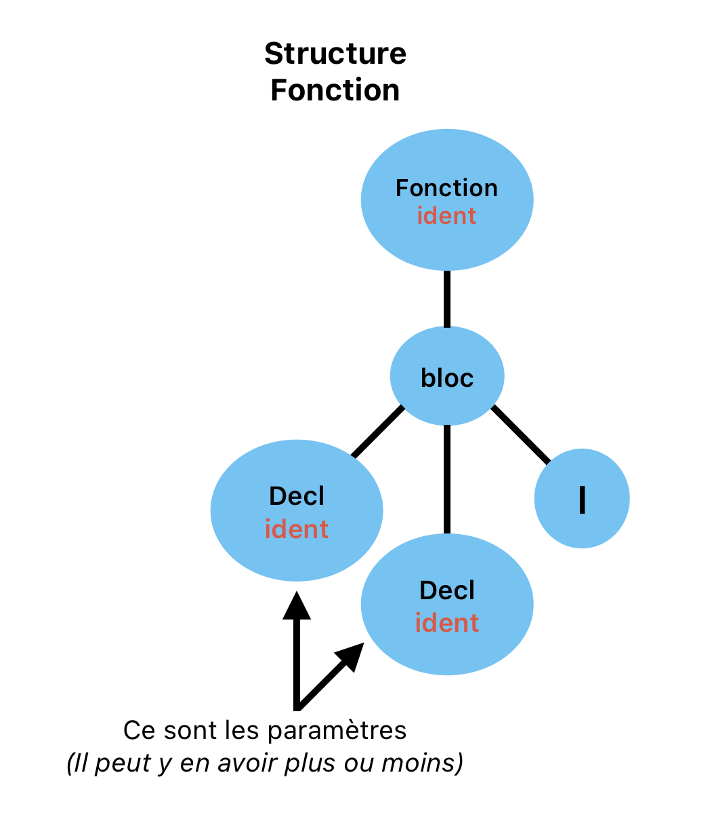
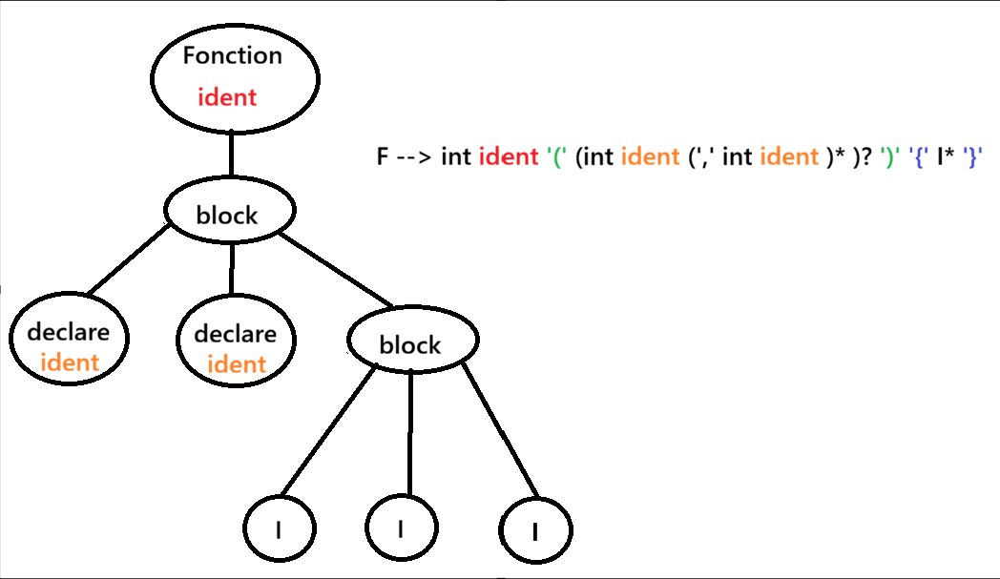
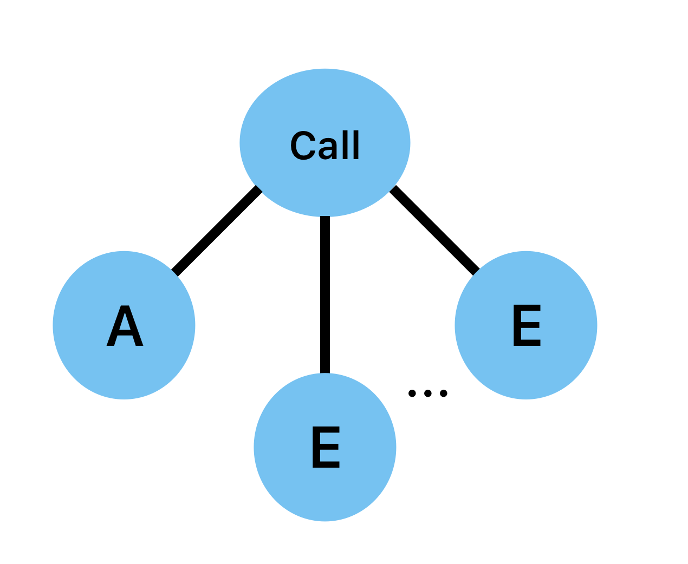
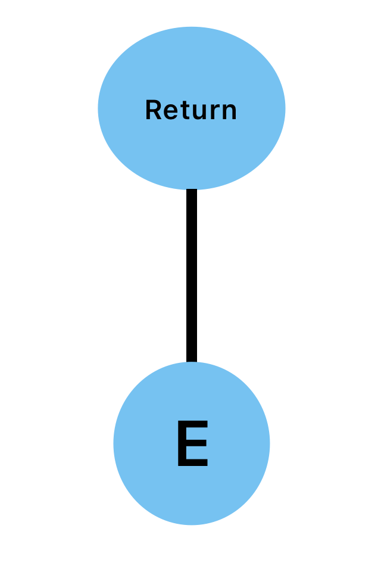
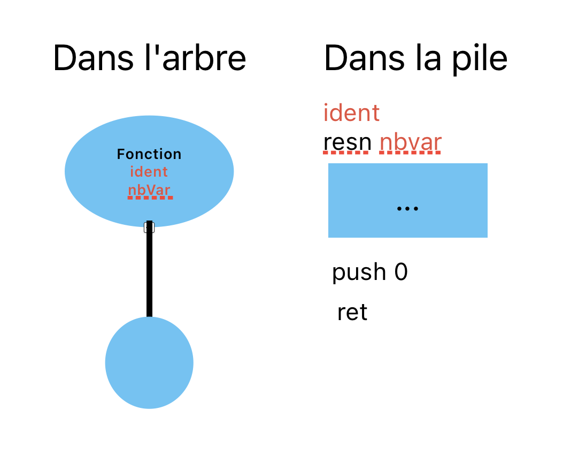
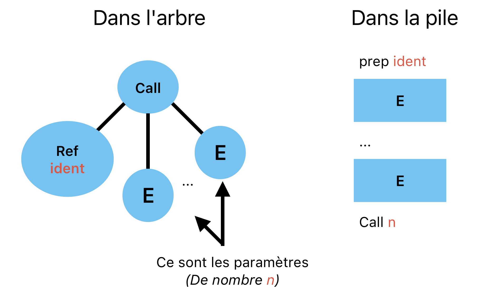
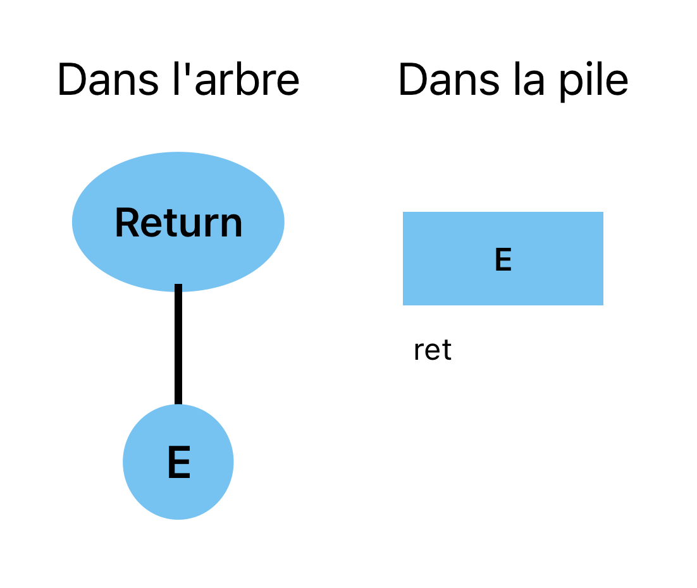

18 November 2026

## Fonctions

La pile d’appel utilise deux pointeurs :

SP → Stack Pointer : la pile termine ici

BP → Base Pointer : la pile commence ici

Une instruction **`get i`** ou **`set i`**calcule à partir de BP, et une instruction `push` ou `pop` est calculée à partir de SP.

Pour les fonctions, on aura les instructions suivantes :

- `prep <label>` comme `prep tacos` pour la fonction `tacos()` → empile deux valeurs : adresse de la fonction `tacos` et ancienne position de BP. SP est au dessus de BP.
- `call i` → récupère l’adresse de `tacos` , saute vers `tacos` et déplace en même temps BP vers la même position que SP. De cette manière, on consacre le reste de la pile pour la fonction. On y place au-dessus les paramètres de la fonction, considérées comme des variables locales. Le paramètre `i` indique le nombre de paramètres de la fonction à placer initialement dans la pile.

  Mais attention, la fonction a une **interdiction stricte** de regarder en dessous de BP.

- `ret` (*return*) → restaure BP vers son ancienne position, dépile les deux valeurs magiques (adresses de `tacos` et ancienne position de BP), puis empile la valeur de retour de la fonction `tacos`. Et bien entendu on met le SP au dessus de cette valeur de retour.

**Regex attendue pour reconnaître une fonction :**

```java
F → int ident '('
		(int ident (',' int ident)* )? // ça ce sont les paramètres de la fonction, qui sont optionnelles
	')' I // I ce sont toutes les instructions
```

**Arbre de la fonction**



**Version de Mathéo** (*qui est plus claire*) **:



**Dans le code de l’analyse syntaxique**

Dans la fonction F :

```java
accept(int);
accept(ident);
Node N = new Node(nd_func, lastToken.ident);
Node B = new Node(nd_bloc);
AjouterEnfant(N,B);
accept(`(`);

while(!check('I')) {
	accept(int);
	accept(ident);
	D = new Node(nd_decl, lastToken.ident);
	AjouterEnfant(B, D);
	check(',');
}
AjouterEnfant(B, I());
return N;
```

Concernant la fonction S (*Suffixe*) pour reconnaître la signature de la fonction, on a cet arbre à construire :



Le A d’ici produit un nœud de type `reference`.

On doit reconnaître la regex suivante :

```java
S -> A ('('(E (',' E)*)? `)` )?
```

Dans le code de l’analyse sémantique de la fonction S :

```java
N = A();
if (check('(') {
	// ... Reste du code à en déduire
}
```

Il ne faut pas oublier le return :

```java
I -> ... | return E; 
```

Dont l’arbre a cette simple structure :



**Code de l’analyse sémantique :**

```java
// Dans semnode

case nd_func:
	declare(N.ident);
	nbVar = 0;
	semnode(N.enfant[0]);
	N.nbvar = nbvar - (N.enfant[0].nbEnfants - !);
	
case nd_call:
	if (N.enfant[0].type != nd_ref) {
		throw new SemanticException("Bâtard t'essaye d'appeler quelque chose qui n'est pas une fonction");
	}
	S = find(N.enfant[0].ident); // Pour s'assurer qu'il y a pas déjà un identificateur avec ce nom
	// Test à rajouter pour la vérification
	
	// Pour chaque enfant e (sauf le premier)
		semnode(e);
```

**Dans le générateur de code :**

**Structure de la fonction**



**Structure de l’appel**



**Structure du return**



**Code du générateur de code :**

```java
// Tant qu'il y a des tokens
	// ... gencode();
	
// Premières instructions 
System.out.println(".start");
System.out.println("prep main");
System.out.println("call 0");
System.out.println("halt");
```

Le reste du code pour générer les instructions msm est à déduire des arbres.